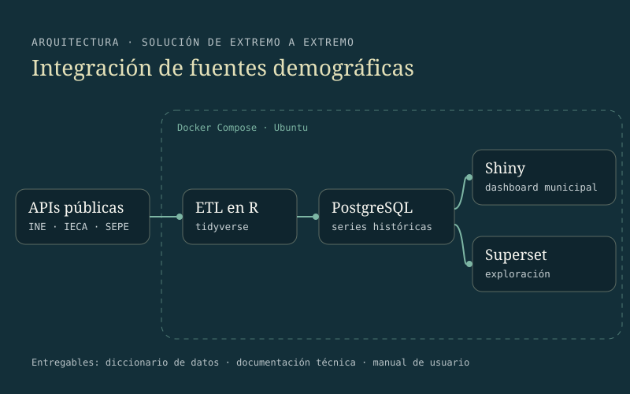
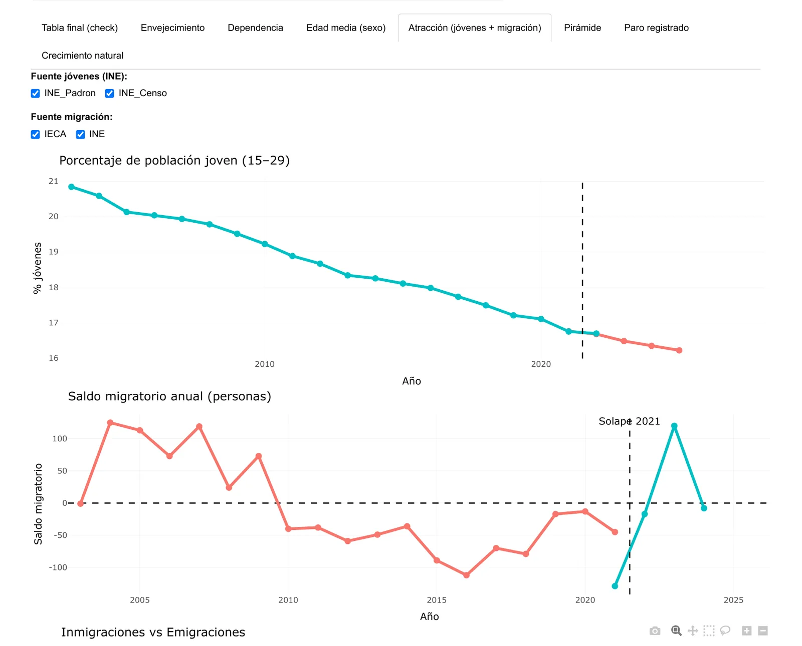
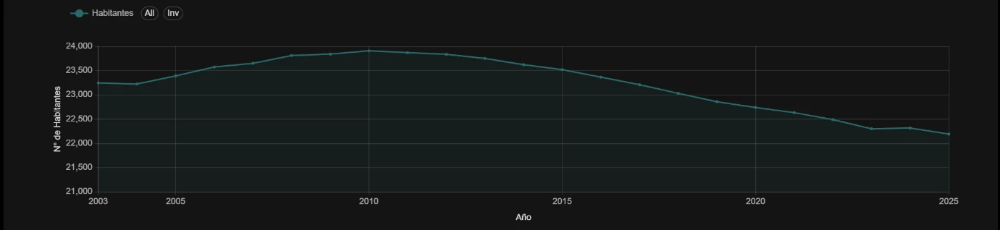
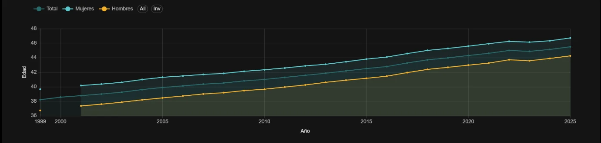
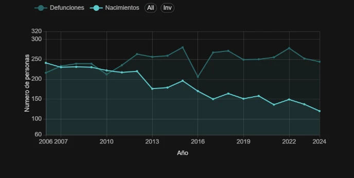
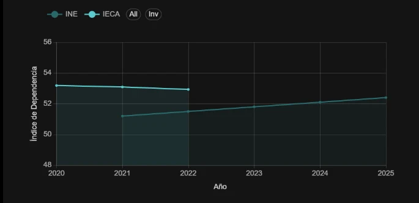
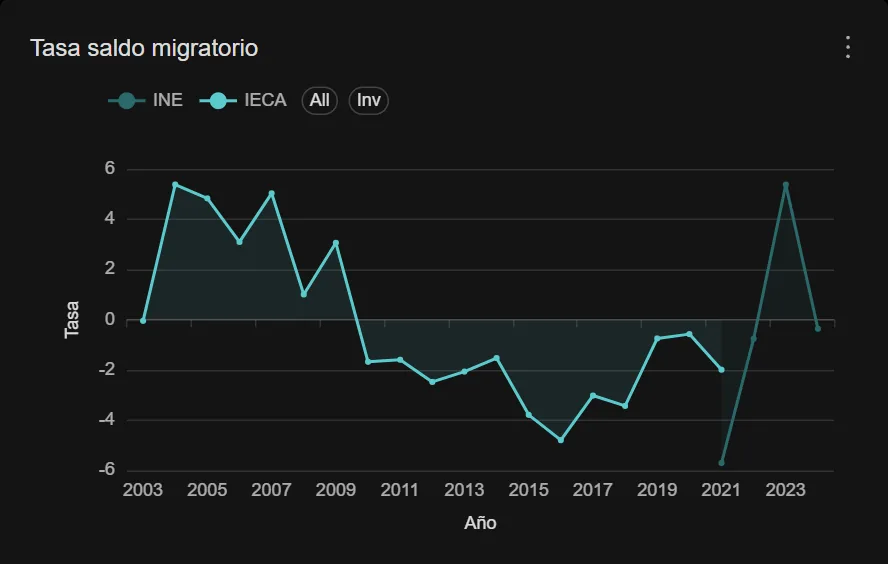

::: {.case-meta}
INTEGRACIÓN Y VISUALIZACIÓN DE DATOS · PRÁCTICAS CURRICULARES · UNIVERSIDAD DE GRANADA · AYUNTAMIENTO DE MONTILLA · MARZO – JUNIO 2026

[R]{.tag} [tidyverse]{.tag} [Shiny]{.tag} [PostgreSQL]{.tag} [Docker]{.tag} [Apache Superset]{.tag} [APIs INE/IECA]{.tag}

[Ver código en GitHub](https://github.com/tomaspieroni-cloud/sistema-demografico-montilla){.btn-tp .btn-tp--secondary}
:::

## Resumen ejecutivo

[El Ayuntamiento de Montilla trabajaba con datos demográficos del INE, el IECA y el SEPE dispersos y sin integrar. Construí un sistema que los reúne en una base PostgreSQL alimentada por procesos ETL en R y los pone a disposición del equipo municipal en un dashboard en Shiny y un panel en Apache Superset con 18 visualizaciones. Todo se despliega con Docker sobre Ubuntu y funciona con software de código abierto, sin coste de licencias.]{.lede}

## Arquitectura

{fig-alt="Diagrama de arquitectura: APIs públicas del INE, IECA y SEPE alimentan un proceso ETL en R que carga una base PostgreSQL; desde ella consultan un dashboard en Shiny y Apache Superset, dentro de un entorno Docker Compose sobre Ubuntu."}

## Qué hice

1. Procesos ETL en R desde las APIs públicas del INE y del IECA.
2. Modelo relacional en PostgreSQL.
3. Dashboard interactivo en Shiny y panel de indicadores en Apache Superset.
4. Despliegue de todo el entorno con Docker Compose sobre Ubuntu.
5. Diccionario de datos, documentación técnica, manual de usuario y presentación ejecutiva.

## El dashboard

{.figure-light fig-alt="Captura del dashboard en Shiny con pestañas temáticas y dos gráficos: el porcentaje de población joven de 15 a 29 años, en descenso desde cerca del 21 % hasta algo más del 16 %, y el saldo migratorio anual en personas, con una línea vertical en 2021 que separa las fuentes IECA e INE."}

## Lo que muestran los datos

Montilla alcanzó su máximo de población en 2010, con 23.907 habitantes, y desde entonces ha perdido más de 1.700, hasta los 22.192 de 2025.

{fig-alt="Gráfico de líneas de la población total de Montilla entre 2003 y 2025. La población crece hasta un máximo cercano a 23.900 habitantes en 2010 y desciende de forma continua hasta unos 22.200 en 2025."}

La edad media subió casi siete años, de 38,8 en 2001 a 45,5 en 2025, con las mujeres unos dos años por encima de los hombres.

{fig-alt="Gráfico de líneas de la edad media en Montilla entre 1999 y 2025, para el total, las mujeres y los hombres. Las tres series suben de forma continua. En 2025, la edad media es de unos 46,7 años en mujeres, 45,5 en el total y 44,3 en hombres."}

Los nacimientos se redujeron a la mitad entre 2006 y 2024, de 241 a 120, y desde 2011 las defunciones los superan todos los años.

{fig-alt="Gráfico de líneas de nacimientos y defunciones en Montilla entre 2006 y 2024. Ambas series parten de valores cercanos a 230. Desde 2011 las defunciones se mantienen por encima de 200 y los nacimientos descienden hasta 120 en 2024."}

## Decisión metodológica principal

La decisión más importante fue **no ocultar las discrepancias entre fuentes**. En 2021 el INE pasó a un censo continuo basado en registros administrativos, y desde entonces sus cifras no coinciden del todo con las del IECA, basadas en el padrón. En 2021, por ejemplo, el índice de dependencia era de 53,1 según el IECA y de 51,2 según el INE. En lugar de imponer una reconciliación, el sistema muestra ambas series y documenta el origen de la diferencia.

::: {.grid}
::: {.g-col-12 .g-col-md-6}
{fig-alt="Gráfico de líneas del índice de dependencia de Montilla según dos fuentes. La serie del IECA, entre 2020 y 2022, se sitúa cerca de 53. La serie del INE, entre 2021 y 2025, parte de 51,2 y sube hasta 52,4."}
:::
::: {.g-col-12 .g-col-md-6}
{fig-alt="Gráfico de líneas de la tasa de saldo migratorio de Montilla. La serie del IECA va de 2003 a 2021, con valores positivos hasta 2009 y negativos después. La serie del INE empieza en 2021 en torno a −6 y sube hasta cerca de 5 en 2023."}
:::
:::

## Limitaciones

- La cobertura temporal depende de la disponibilidad de cada serie en las fuentes originales.
- El sistema está pensado para un municipio; extenderlo a otros exige revisar las correspondencias geográficas.

```{=html}
<div class="back-link btn-row"><a class="btn-tp btn-tp--secondary" href="../proyectos.html">Volver a Proyectos</a><a class="btn-tp btn-tp--ghost" href="https://github.com/tomaspieroni-cloud/sistema-demografico-montilla">Ver código en GitHub</a></div>
```
